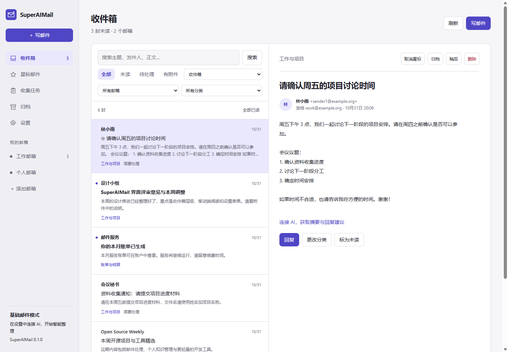
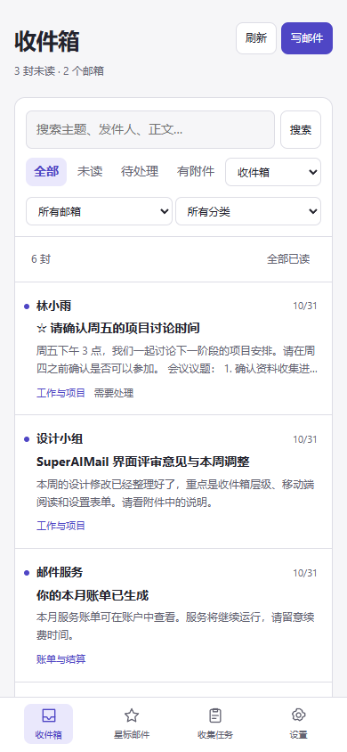
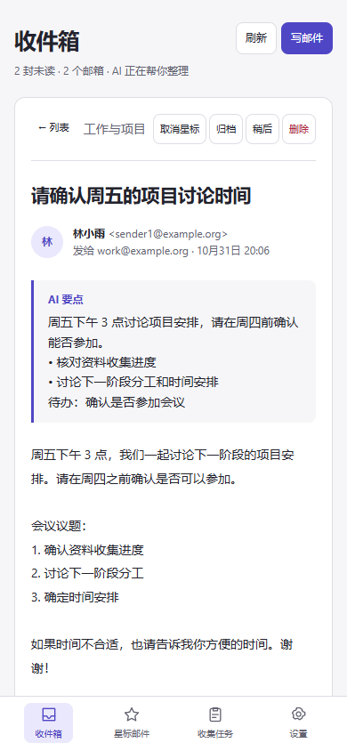
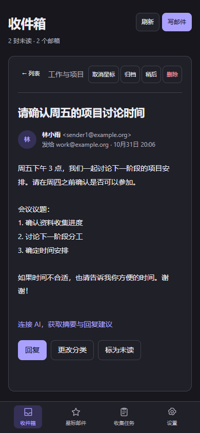
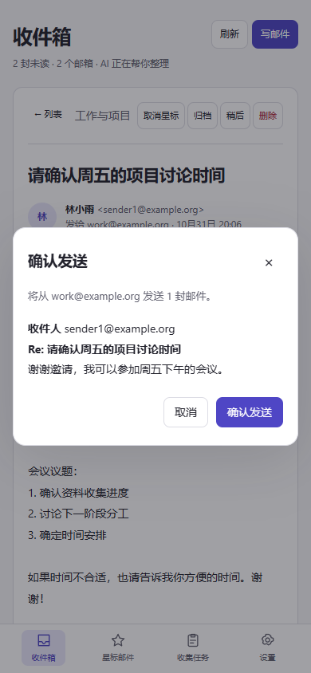
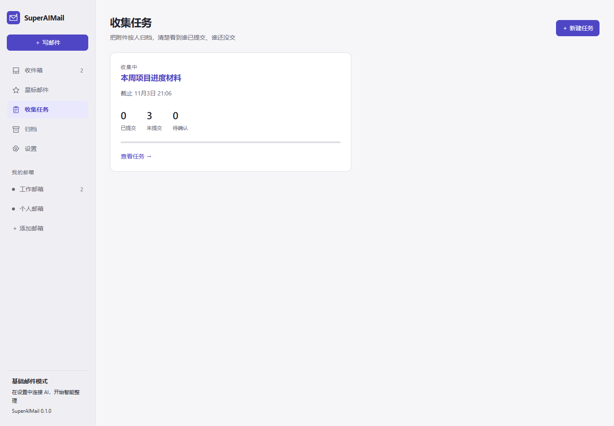
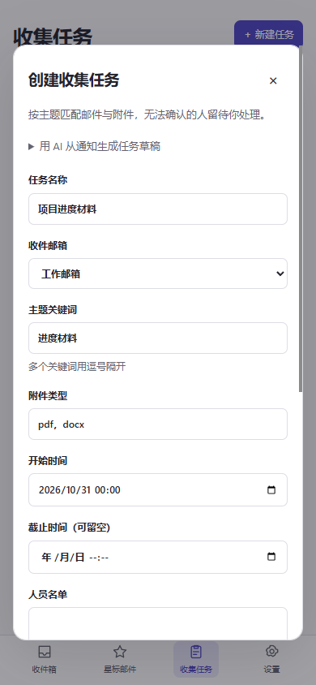
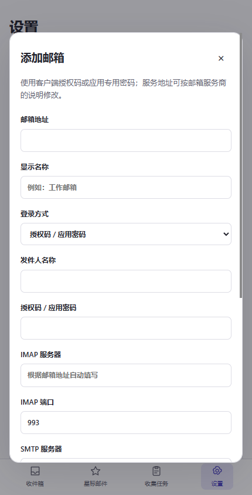

<div align="center">

# SuperAIMail

**把多个邮箱放在一起，把注意力留给重要的邮件**

电脑、手机都能独立运行，也可以共用一个后台。<br>
连接自己的 AI，帮你分类、提炼要点、翻译、起草回复，把收集的附件按人整理好。

[](https://github.com/KangWang42/superaimail/releases/latest)
[](https://github.com/KangWang42/superaimail/releases)

[](LICENSE)

[下载](https://github.com/KangWang42/superaimail/releases/latest) · [三步开始](#三步开始) · [功能图解](#功能图解) · [邮箱教程](docs/MAILBOXES.md) · [AI 设置](docs/AI.md) · [自托管](docs/SELF_HOSTING.md)



</div>

截图使用合成演示邮件。手机配图展示响应式界面，不作为 Android 真机验收证据；AI 示例由隔离的兼容接口返回，用于说明操作方式。

## 什么时候用得上

- **几个邮箱来回切。** 工作、个人、学校和自定义邮箱集中收件，按邮箱、分类、未读和附件筛选。
- **邮件很多，不知道先处理哪封。** AI 提炼要点、识别待办和关注程度，原文随时可以核对。
- **外文邮件需要回复。** 翻译正文、起草回复，修改后先预览，再亲自确认发送。
- **收作业、项目材料或报名附件。** 按主题和名单收集，区分已交、未交、待确认，保留重复提交的历史版本，导出 ZIP。

SuperAIMail 不提供公共邮件托管或模型账号。邮箱和模型服务都使用你自己的配置；AI 默认关闭，基础收件、搜索、规则、附件收集和手动发信仍可使用。

## 能做什么

| 基础邮件功能 | 连接 AI 后的增强 |
|---|---|
| 多个 IMAP 邮箱集中收件、历史补收与搜索 | 按你定义的分类整理新邮件 |
| 阅读正文、安全显示邮件排版、下载附件 | 判断哪些邮件需要处理、哪些是普通通知 |
| 星标、归档、回收站、稍后处理、全部已读 | 提炼摘要、要点、待办与邮件中明确的时间 |
| 撰写与回复；先预览，再确认发送 | 起草回复，由你修改并确认发送 |
| 规则匹配、验证码识别、代理出口 | 翻译正文、用自然语言查找邮件 |
| 按任务收集附件、人员名单、版本保留、ZIP 导出 | 辅助判断附件所属任务与提交人、整理文件名 |

AI 默认关闭。没有模型服务或关闭 AI 时，收件、阅读、搜索、规则、附件收集和手动发信照常工作。模型连接失败也不会中断收件。

邮件保存在运行 SuperAIMail 后台的设备上。本项目不提供公共邮件托管，不收集邮箱凭据，也不内置付费模型账号。启用 AI 后，相关邮件内容会发送到你配置的服务；可以使用本机模型，让模型请求也留在本机。

## 三步开始

在 [最新 Release](https://github.com/KangWang42/superaimail/releases/latest) 下载需要的安装包。**电脑和手机可以只安装其中一个，不要求成对安装。**

| 设备 | 文件 | 要求 |
|---|---|---|
| Windows 电脑 | `SuperAIMail-0.1.0-Windows-Setup.exe` | Windows 10/11 x64、WebView2；内含 Python 后台 |
| Android 手机 | `SuperAIMail-0.1.0-Android-universal.apk` | Android 8.0+、64 位 ARM / x86_64；内含 Python 后台 |
| 浏览器、iPhone / iPad | 访问自己部署的服务 | iOS 可添加到主屏幕，依赖在线后台 |

**1. 安装并打开，设置工作台密码。** 本机模式的邮件和凭据保存在这台设备。工作台密码保护应用访问，与邮箱授权码不同。

**2. 添加邮箱，测试后保存。** 进入「设置 → 我的邮箱」，填写完整邮箱地址和客户端授权码。常用邮箱会自动填写服务器；Outlook 选择 Microsoft OAuth。逐步说明见[邮箱教程](docs/MAILBOXES.md)。

**3. 连接 AI，开启智能整理。** 在「设置 → AI 助手」填兼容接口地址、模型名称和 API Key，开启并保存。先打开一封邮件试用「AI 提炼要点」，再设置自动分类。也可使用自己的本机模型，见 [AI 教程](docs/AI.md)。

<details>
<summary><b>从源码启动，不使用安装器</b></summary>

<br>

源码运行需要已有的 Python 3.11 或以上版本，邮件后台没有第三方 Python 依赖：

```sh
git clone https://github.com/KangWang42/superaimail.git
cd superaimail
python -m superaimail
```

浏览器打开 `http://127.0.0.1:8787`，按照上面的第 1 至 3 步操作。Linux/macOS 也可使用这条路径。

</details>

<details>
<summary><b>安装、升级与后台收件</b></summary>

<br>

Windows 安装器没有商业代码签名，Android APK 使用项目固定密钥签名。只从本仓库 Release 下载，并比较 SHA-256。升级时覆盖安装，先备份数据。

电脑关闭窗口后本机后台退出；Android 受系统省电影响，不保证锁屏持续收件。当前没有默认保活、开机启动或自动更新。持续在线收件请使用共享后台。系统要求、数据位置和构建方法见[安装教程](docs/INSTALL.md)。

</details>

访问密码只保护这个工作台，与邮箱授权码是两件事。不要把邮箱网页登录密码填入不支持密码登录的邮箱；QQ、网易通常需要客户端授权码，Gmail 通常需要应用专用密码，Outlook 使用 Microsoft OAuth。详见[逐个邮箱的设置教程](docs/MAILBOXES.md)。

## 功能图解

### 收件箱：先找到要处理的邮件

<p align="center">  </p>

收件箱、星标、归档、回收站、稍后处理和已发送使用同一个邮件索引。普通搜索查询主题、发件人和已存正文；AI 查找可把“上周带附件的账单”转换成筛选条件。全部已读对当前筛选的所有分页生效。

### AI 与发信：建议可修改，发送由你确认

<table>
<tr>
<td width="50%" align="center" valign="top"></td>
<td width="50%" align="center" valign="top"></td>
</tr>
<tr>
<td valign="top"><b>少读重复内容。</b> AI 提炼摘要、要点、待办和明确的时间，也可翻译和起草回复。分类描述与关注程度可调整；模型失败不阻断收件。</td>
<td valign="top"><b>保留最后一步。</b> 手写和 AI 草稿都先预览真实收件人、抄送、主题和正文，再显式确认。AI 不会自行发送回复、催交或回执。</td>
</tr>
</table>

### 收集任务：按人整理附件，保留每次提交

<p align="center"></p>

新建任务时填写主题关键词、附件类型、截止时间和人员名单，也可以粘贴通知生成可编辑的 AI 草稿。无法确认的人放到待确认列表；确认之后可记住对应关系。重复提交保留历史版本，ZIP 可选择最新文件或包含历史。

<details>
<summary><b>查看任务草稿与邮箱设置界面</b></summary>
<br>
<p align="center"> </p>

从 [使用指南](docs/GUIDE.md) 查看完整操作、命名模板和状态含义。每个邮箱都能在设置中添加、修改、停用或删除；AI、分类规则、网络出口与外观也集中在设置中。
</details>

## 电脑、手机怎样搭配

| 用法 | 后台运行位置 | 数据与收件 |
|---|---|---|
| 电脑本地使用 | 电脑 | 邮箱数据在电脑上；后台运行时收件 |
| 手机独立使用 | Android 手机内置后台 | 不依赖电脑；Android 的后台限制会影响持续收件 |
| 电脑、手机共用 | 你部署的一台电脑或服务器 | 两端访问同一服务，邮件、任务和设置一致 |
| 浏览器 / 添加到主屏幕 | 连接你运行的服务 | 适用于手机和平板；iOS 使用这种方式 |

各设备独立运行时，各自保存凭据和索引，不会自动合并状态。想共享状态，请让设备连接同一服务。服务必须在线，远程访问建议使用有有效证书的 HTTPS。部署方法见[自托管教程](docs/SELF_HOSTING.md)。

## 邮箱兼容

支持使用 TLS 的 IMAP 收件，以及 SMTP TLS / STARTTLS 发信；支持可选的 SOCKS5 代理。提供 QQ / Foxmail、163 / 126 / yeah、Gmail、Outlook / Hotmail / Live、iCloud、Yahoo、AOL、Fastmail、新浪、搜狐预设，自定义域名邮箱可手动填写服务器。

Microsoft OAuth 需要注册自己的公共客户端应用，授权与续期在本应用中完成。企业邮箱还受管理员的 IMAP / SMTP 策略影响。本项目不直接支持 POP3、Exchange EWS、仅明文或自签证书的 Bridge（包括未适配的 Proton Bridge），也不支持没有开放 IMAP 的邮箱。预设表示可填写相应协议参数，不等于所有账号和套餐都允许第三方客户端。

## 邮件与文件的处理方式

- IMAP 连接只读。已读、星标、归档、删除和稍后处理均为本应用的本地状态，不会删除或移动原邮箱的邮件。
- 默认首次读取近 60 天，设置中可补收近 180 天。索引默认保留 180 天；收集任务引用的邮件保留，任务附件单独归档。
- 邮件中的脚本、表单和不安全内容会过滤；排版正文放在隔离框架中，远程图片默认关闭。
- 邮件发送需要先生成预览，再由你确认。AI 不会自行发送回复、回执或催交通知。
- 附件按任务与提交人整理，保留原始文件名、校验值和历史提交；不执行附件里的宏、公式或程序。
- 当前发信为纯文本；已发邮件保存在本地「已发送」，不自动上传到邮箱服务商的已发送文件夹。

具体操作与常见问题见[使用指南](docs/GUIDE.md)。

## 运行与配置

```sh
python -m superaimail --help
python -m superaimail --data ./data --port 8787 --no-browser
python -m superaimail init --data ./data
```

| 参数 / 环境变量 | 用途 |
|---|---|
| `--data` / `SUPERMAIL_DATA` | 数据根目录 |
| `--host` / `SUPERMAIL_HOST` | 监听地址，默认 `127.0.0.1` |
| `--port` / `SUPERMAIL_PORT` | 端口，默认 `8787` |
| `--public-url` / `SUPERMAIL_PUBLIC_URL` | 对外使用的完整地址，决定来源校验与安全 Cookie |
| `--no-browser` | 后台运行时不打开浏览器 |
| `SUPERMAIL_PASSWORD_FILE` | 仅首次初始化时从文件读取访问密码，便于容器部署 |

默认数据目录：Windows 为 `%LOCALAPPDATA%/SuperAIMail/data`；Linux 为 `$XDG_DATA_HOME/superaimail`，未设时用 `~/.local/share/superaimail`。

数据目录包含邮箱凭据、OAuth 令牌、邮件索引和附件，需要作为整体保护与备份。不要提交到 Git。迁移时先停止后台，完整复制数据目录，再在目标设备启动。

## 开发

```sh
python -m unittest discover -s tests -v
python -m compileall -q superaimail
node --check superaimail/web/app.js
```

核心目录：

```text
superaimail/
  engine/      IMAP、SMTP、OAuth、AI、索引、收集任务、邮件内容过滤
  app.py       独立 HTTP 服务、同源校验和静态资源
  auth.py      访问密码与浏览器会话
  api.py       邮件接口与发送预览
  web/         电脑和手机共用的响应式工作台
tests/         隔离回归测试与本机协议测试
docs/          邮箱、AI、部署与日常使用教程
```

测试不访问真实邮箱或生产服务。模型协议测试使用本机隔离 HTTP 服务；Microsoft OAuth 测试在网络边界替换远程响应，不代表已连接你的微软账号。

## 参与与许可

欢迎通过 [Issues](https://github.com/KangWang42/superaimail/issues) 报告问题，附应用版本、邮箱类型和已遮盖个人信息的错误描述。请不要上传邮箱授权码、API Key、原始数据目录或带有私人正文的日志。

| 文档 | 内容 |
|---|---|
| [安装与构建](docs/INSTALL.md) | Windows、Android、源码运行、升级与数据位置 |
| [邮箱教程](docs/MAILBOXES.md) | QQ、网易、Gmail、微软 OAuth、iCloud 等逐项说明 |
| [AI 设置](docs/AI.md) | 兼容接口、本机模型、额度、隐私与排错 |
| [使用指南](docs/GUIDE.md) | 收件、发信、收集任务、分类、数据与常见问题 |
| [自托管](docs/SELF_HOSTING.md) | HTTPS、systemd、Docker、PWA、备份回退 |
| [参与开发](CONTRIBUTING.md) | 测试、提交和发布要求 |
| [安全说明](SECURITY.md) | 凭据、传输、AI 与漏洞报告 |

本项目从个人邮件后台中独立整理，采用 [MIT License](LICENSE)。[第三方组件](THIRD_PARTY.md)保留各自许可；邮件服务商与模型服务商的条款仍适用。
